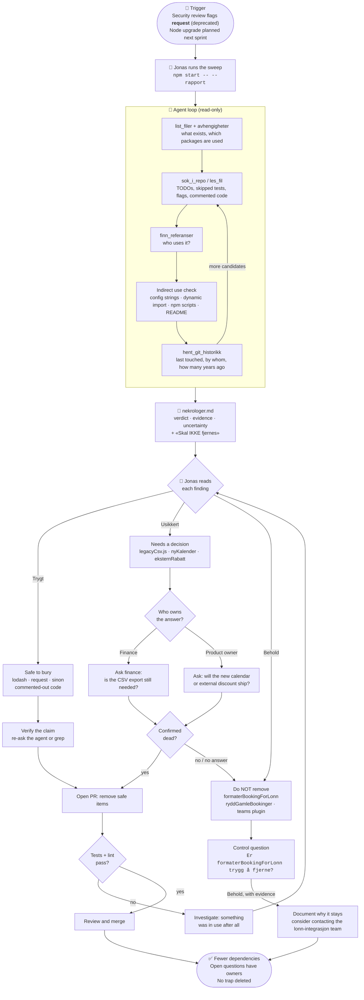

# Flowchart: cleaning up Romvakt before the Node upgrade

Based on the scenario in [scenario.md](scenario.md). The agent only reads and reports. Every deletion is a human decision.

## Reading the chart

| Lane | Who acts | What can go wrong | Safeguard |
|---|---|---|---|
| Agent loop | Agent | Misses indirect use, or cites a search that didn't really run | Mandatory indirect-use check, evidence listed in the report, regex hint in `sok_i_repo` |
| Review | Jonas | Trusting a verdict blindly | The report states what was not checked, and every deletion goes through a PR |
| Unsure branch | Finance, product owner | No answer arrives | «No answer» defaults to keeping the code |
| Keep branch | Jonas | Someone later deletes it again | Documented reason in the repo |

## Real numbers from the project

- The sweep task used 37 tool calls and mentioned 9 of 9 safe items in the eval. Its own duration wasn't logged: all three eval tasks together took 1m12.
- The control question took 3 rounds and 5 tool calls, and ended with Dom: Behold.
- The eval run was a single run, and the agent is not deterministic.
